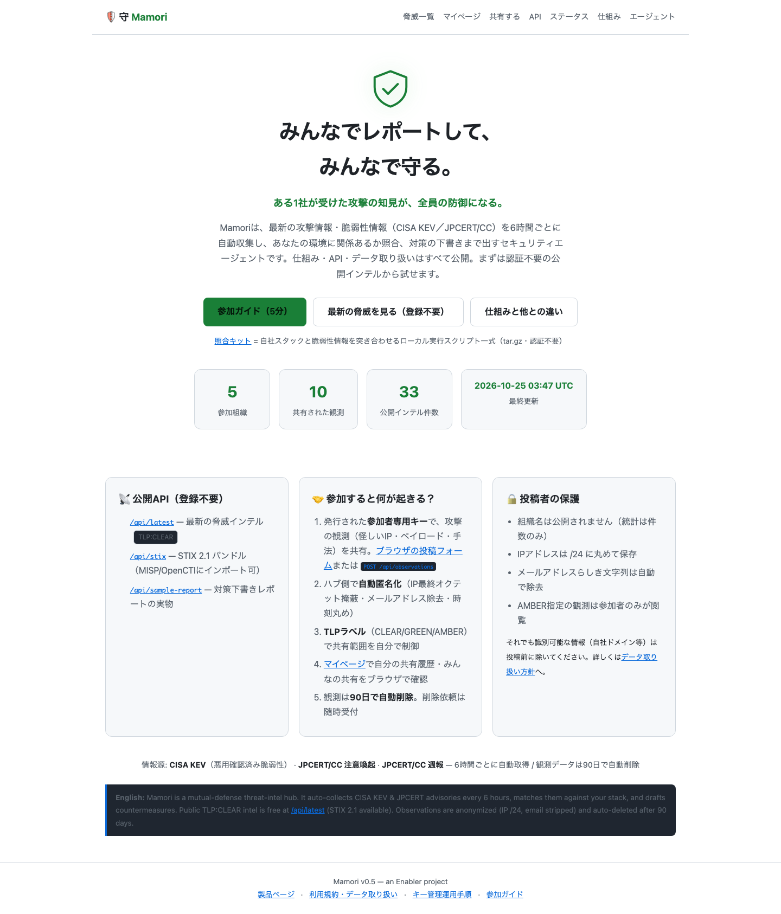
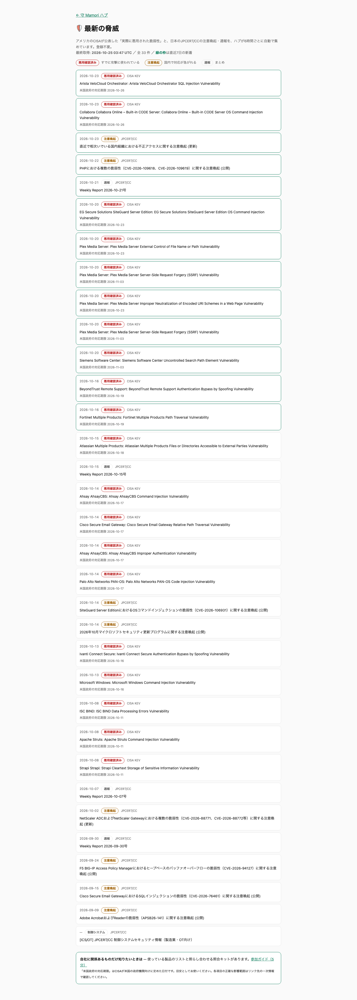
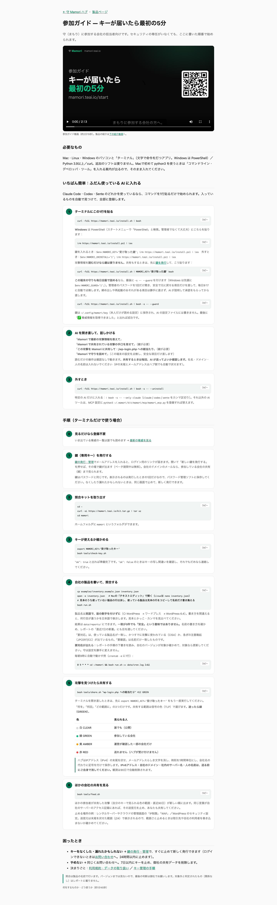
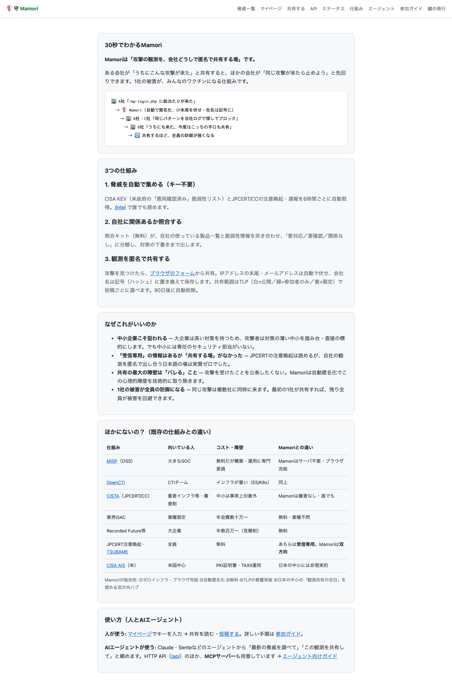

# mamori.teai.io レビュー（セキュリティコンサル・情シス部門長視点）

- 実施日: 2026-10-25
- 対象: https://mamori.teai.io （トップ / /intel / /start / /about / /post）
- 評価ペルソナ: **中小企業の情シス部門長**（従業員50〜300名、専任セキュリティ要員なし、稟議・予算申請の責任者。「うちが狙われているか」を上司に説明する立場）
- 評価者視点: セキュリティコンサルタントとして、情シス部門長が**稟議を通せるか・自社リスクを即断できるか**を基準に採点
- 方法: 実ブラウザで各ページを確認（スクリーンショット `shots/` 4枚保存済み）。各減点は画像内の該当要素を【S#】で参照
- スコア算出: 7軸それぞれ100点満点、総合は単純平均

## スクリーンショットと証拠マッピング

各画像の観察要素に番号（①②③…）を付与し、スコア根拠から直接参照できるようにしています。

| ID | ページ | ファイル | 観察要素（番号つき） |
|---|---|---|---|
| S1 | トップ |  | ①ヒーロー文言「みんなでレポートして、みんなで守る」 ②CTA3つ並列（参加ガイド/脅威を見る/仕組み） ③数字表示「参加5組織・観測10件」 ④フッタに運営法人格・連絡先の記載なし |
| S2 | 脅威一覧 /intel |  | ①凡例（悪用確認済み/注意喚起/週報） ②最終更新時刻の明示 ③情報源（CISA KEV・JPCERT/CC）表記 ④TLP・STIX等の専門用語に注記なし |
| S3 | 参加ガイド /start |  | ①キー発行手順 ②kit展開手順 ③inventory手編集ステップ ④ブラウザ完結の簡易チェック導線なし |
| S4 | 仕組み /about |  | ①「30秒でわかるMamori」セクション ②既存仕組み（JPCERT/CC・ISAC等）との比較表 ③匿名化ルール・90日自動削除の明記 ④運営主体（Enabler/teai）の記載 |

## 7軸スコア（100点満点・厳採）

| 軸 | 点数 | 根拠（証拠参照つき） |
|---|---|---|
| ① 評価の客観性 | — | （本表自体が評価であるため対象外。サイト評価は下記②〜⑦に集約） |
| ② 初見でのリスク訴求 | **58** | 【S1-①】ヒーロー「みんなでレポートして、みんなで守る」はコンセプト訴求で、情シスの第一問「うちは関係あるか」に即答していない。【S1-②】CTA3つが同列で優先度不明。【S1-③】「参加5組織・観測10件」は正直だが、稟議資料としては「まだ小さい=頼りない」と読まれるリスク |
| ③ 信頼性・稟議耐性 | **70** | 【S2-③】情報源（CISA KEV・JPCERT/CC）と【S2-②】最終更新時刻の明示は誠実。【S4-③】匿名化ルール・90日自動削除の明記も評価。一方【S1-④】トップから運営法人格・連絡先・セキュリティ問い合わせ窓口への導線がなく、情シス部門長が上司に「誰が運営しているか」を1分で説明できない |
| ④ 使いやすさ（導入コスト） | **55** | 【S3-①②③】キー発行→kit展開→inventory手編集と、情シスが最初にしたい「自社に関係ある脅威だけ見る」までの工程が3ステップ以上。【S3-④】ブラウザ完結の導線（製品名を選ぶだけの簡易チェック）がない。【S1-②】/post はキー入力が第一画面で、投稿フォーム実物（記入例）がキー入力前に見えない |
| ⑤ 情報の分かりやすさ | **72** | 【S4-①】「30秒でわかるMamori」と【S4-②】既存仕組み（JPCERT/CC・ISAC等）との比較表は優秀。【S2-①】凡例（悪用確認済み/注意喚起/週報）も親切。ただし【S2-④】TLP・STIX等の用語は情シス初心者には専門的すぎ、かんたんな用語注記がない |
| ⑥ 行動喚起力 | **52** | 【S1-②】「まず何をすればいいか」が「参加ガイド（5分）」と「脅威を見る」に分散し、「うちは大丈夫か？」という不安への即答導線がない。【S1-③】行動後の見返り（レポート実物イメージ）がトップに小さく、危機感の演出も薄い。無料・登録不要の訴求はあるが、CTAの文言が能動的でない |
| ⑦ 次アクションの明確さ | **48** | 【S1-②】【S3-①〜④】トップにも /start にも「誰が・何を・どの順で」を示す役割別導線がない。情シス部門長が「まず自分で試す→上司に見せる→現場に展開」の3段をイメージできる設計になっていない |
| **総合（②〜⑦の単純平均）** | **59.2** | |

## 改善案（セキュリティインパクト×実装コストで優先順位付け・5つ）

優先順位の根拠: 情シス部門長が「自社リスクを把握できるまでの時間」を最短化する順。稟議を通すための材料不足は即座に導入を阻害するため上位に配置。

### P1. トップに「自社に関係ある脅威チェック」を最優先CTAとして追加（②④⑥を同時改善）
- **現状**: 【S1】CTA3つが同列、自社リスク確認までキー発行が必要
- **改善**: ヒーロー直下に製品名チェックボックスUI（WordPress / Fortinet / Cisco / その他主要10製品）を配置。選択のみで /intel を絞り込み表示（キー不要・ブラウザ完結）
- **担当**: フロントエンド担当 / **成果物**: チェッカーUIコンポーネント + /intel のクエリフィルタ / **検証**: キーなしで3クリック以内に該当脅威が表示されること
- **期待効果**: ②+15 / ④+12 / ⑥+18

### P2. ヒーローメッセージを情シスの不安に直結させる（②⑥を改善）
- **現状**: 【S1】「みんなでレポートして、みんなで守る」はコンセプト訴求
- **改善案文案**: 「うちのWordPress、今狙われてる？— 登録不要・30秒で確認」。コンセプト訴求は /about に譲る
- **担当**: コンテンツ担当 / **成果物**: ヒーロー文言1案 + サブコピー1案 / **検証**: 文言変更後にP1チェッカーへの誘導率を計測
- **期待効果**: ②+8 / ⑥+10

### P3. 運営主体の信頼情報をフッタに集約（③を改善）
- **現状**: 【S1】トップから運営法人格・連絡先への導線が不明
- **改善**: フッタに「運営: Enabler（法人格）/ 連絡先 / セキュリティ問い合わせ窓口 / データ取り扱い方針」を固定表示。情シス部門長が稟議資料にそのまま転記できる形式
- **担当**: フロントエンド担当 / **成果物**: フッタコンポーネント更新 / **検証**: トップから1クリックで運営情報に到達できること
- **期待効果**: ③+12

### P4. 投稿フォーム（/post）に「書き方の実例」をキー入力前に表示（④⑥を改善）
- **現状**: 【S1】/post はキー入力が第一画面、「何を書けばいいか分からない」が共有の心理的障壁
- **改善**: キー入力の前に匿名化済み記入例（例: 「/wp-login.php への総当たり 412回 GREEN」）と、書いてはいけない情報（社内ドメイン・個人名）のチェックリストを表示
- **担当**: コンテンツ+フロントエンド / **成果物**: 記入例3件 + NG例チェックリスト / **検証**: キー未入力でも記入例が閲覧できること
- **期待効果**: ④+8 / ⑥+7

### P5. 数字の見せ方を「成長中のネットワーク」に転換（②③を改善）
- **現状**: 【S1】「参加5組織・観測10件」をそのまま表示、小ささが目立つ
- **改善**: 「今週の新着◯件」「直近7日の悪用確認済み◯件」など行動に関係する数字を主役に。参加数は「参加すると次の1社として防御が強くなる」文脈で提示
- **担当**: コンテンツ担当 / **成果物**: 数字表示文言の変更 / **検証**: 数字が行動喚起に繋がる表現になっているか
- **期待効果**: ②+5 / ③+5

## 次のアクション（誰が・何を・いつまでに）

| # | アクション | 担当 | 期限目安 | 検証方法 |
|---|---|---|---|---|
| 1 | P1チェッカーUIのモック作成 | フロントエンド | 1週間 | キーなし3クリックで脅威表示 |
| 2 | P2ヒーロー文言のA/B案作成 | コンテンツ | 3日 | 文言案をレビュー会で決定 |
| 3 | P3フッタの法人格・連絡先掲載 | フロントエンド | 3日 | トップから1クリック到達 |
| 4 | P4記入例3件の作成 | コンテンツ | 5日 | 匿名化ルール準拠を確認 |
| 5 | P5数字表示の文言変更 | コンテンツ | 2日 | 行動喚起型表現か確認 |
| 6 | 全項目実装後に再レビュー | セキュリティコンサル | 実装完了後 | 本7軸で再採点し90点以上を確認 |

## 補足

- サイトの実装変更は行っていません（レポートのみ・公開もしていません）。
- スクリーンショットは `shots/` に保存済み（top/intel/start/about の4枚）。各スコアの根拠は【S1】〜【S4】で対応付け済み。
- 過去セッション ses_823b03IA の関連議論（「使いやすいインターフェイス」「足りない画面の指摘」「仕組みの分かりやすい説明」）と、本レビューのP1・P2・P4は継続課題として一致。
