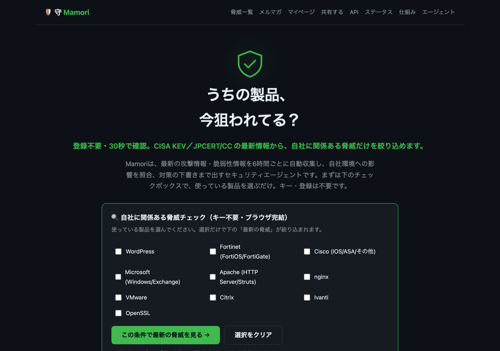
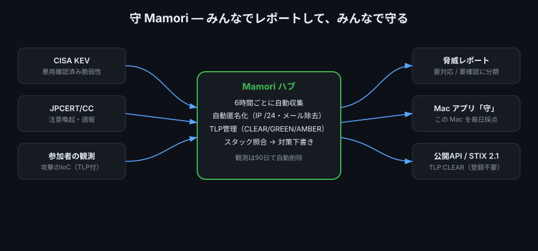
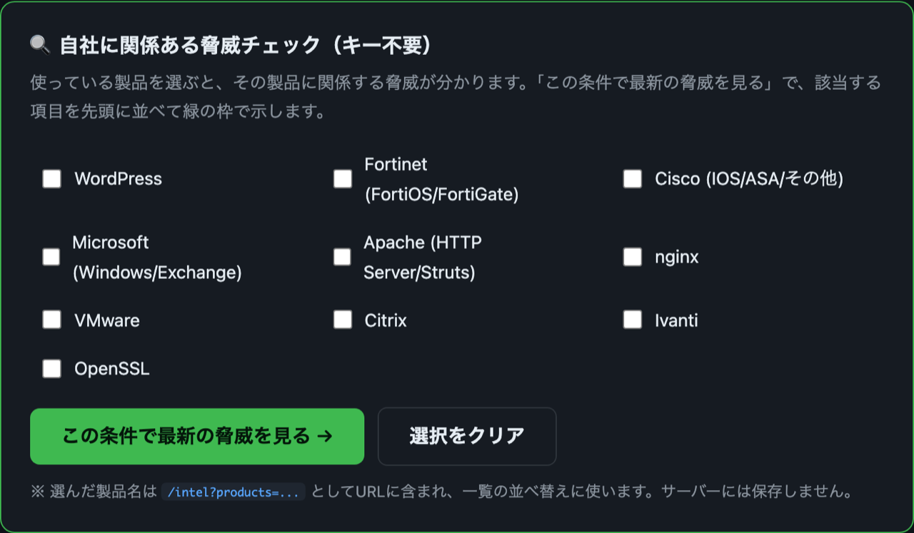
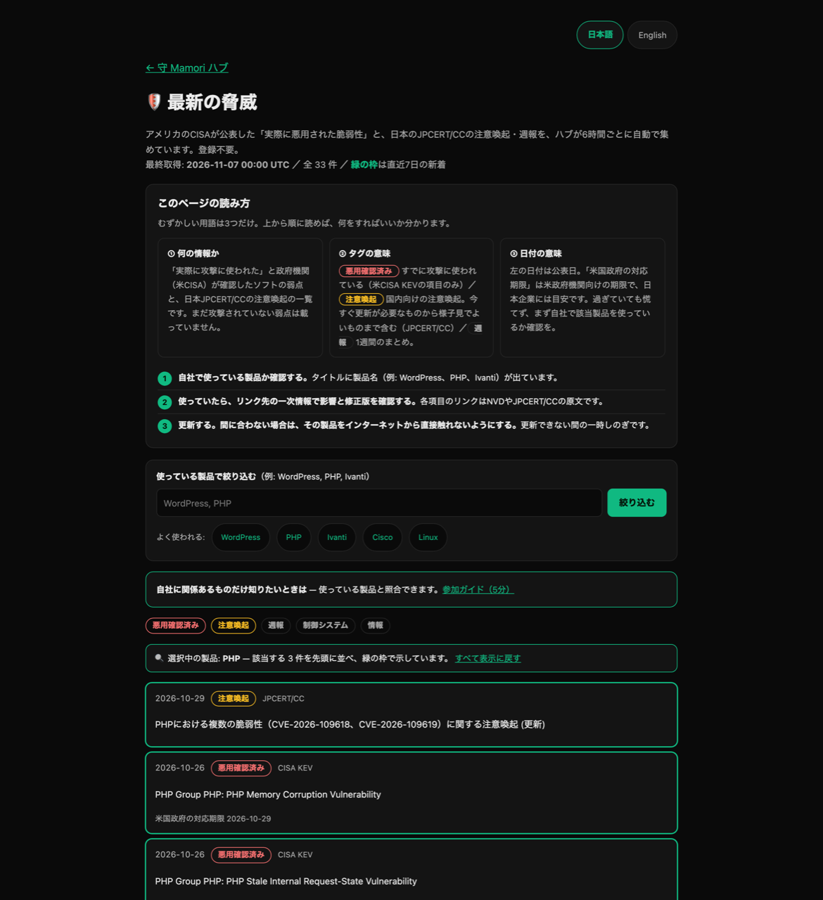
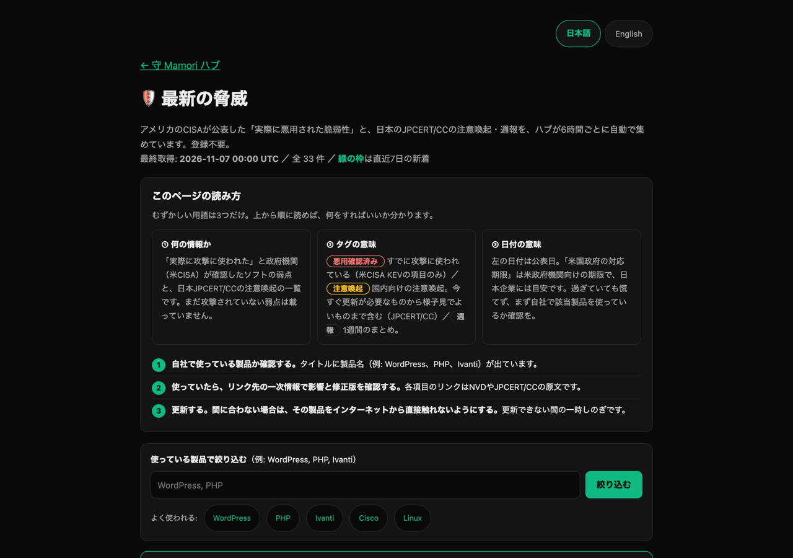
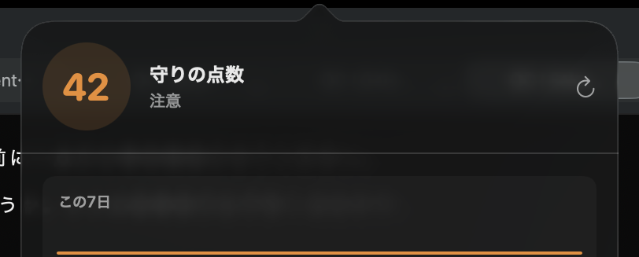
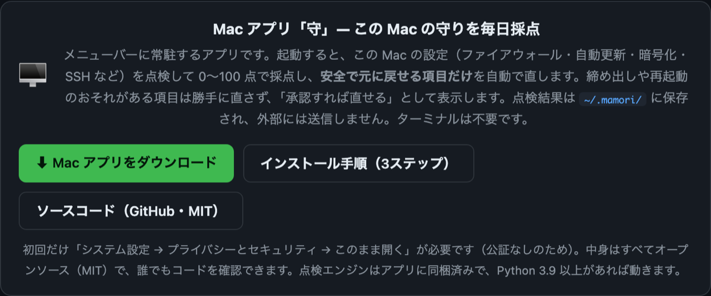
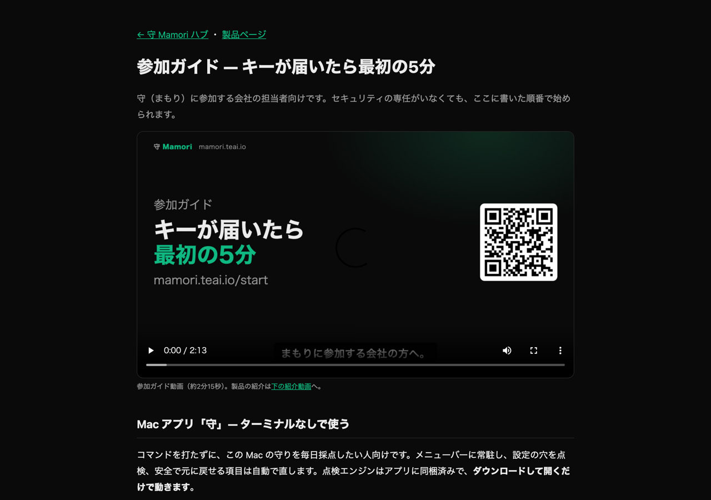
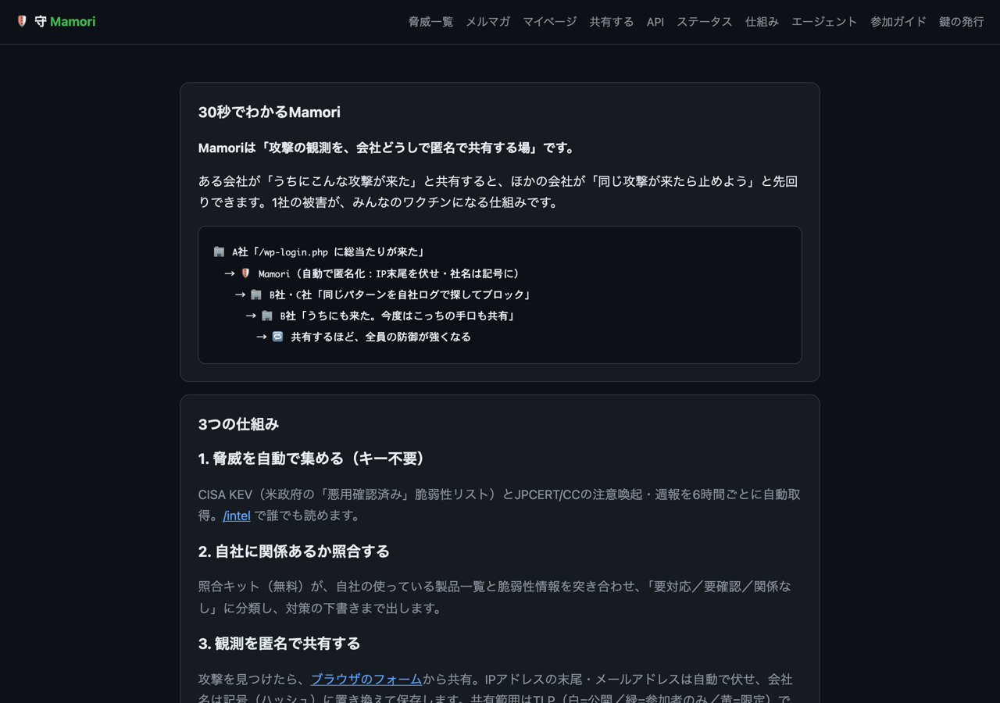

# 守（Mamori）— 中小企業のための脅威インテル＋端末点検

**みんなでレポートして、みんなで守る。**

[](LICENSE)
[](https://www.python.org/)
[](#設計メモ)
[](https://mamori.teai.io/)

> うちの製品、今狙われてる？ — 登録不要・30秒で確認。CISA KEV／JPCERT/CC の最新情報から、自社に関係ある脅威を先頭に集めます。

朝、出社してまず `https://mamori.teai.io/` を開き、使っている製品にチェックを入れて「この条件で最新の脅威を見る」を押す。今週の要対応が5分で分かる——そんな使い方を想定しています。



Mamoriは、最新の攻撃情報・脆弱性情報を自動で集め、自分の環境への適用範囲を照合し、対策の下書きまで出すセキュリティエージェントです。ある1社・1人が受けた攻撃の知見（IoC）をTLP管理つきで共有し、全員の防御に変える「集団免疫」を目指します。

| リンク | URL |
|---|---|
| ハブ（実際に使える） | https://mamori.teai.io/ |
| Live Intel（認証不要・TLP:CLEAR） | https://mamori.teai.io/api/latest |
| 公開カウンタ | https://mamori.teai.io/api/stats |
| 参加ガイド | https://mamori.teai.io/start |
| 照合キット | https://mamori.teai.io/kit.tar.gz |
| 製品ページ | https://teai.io/mamori |

**提供形態**: 現在はベータ・無料です（参加者キーの発行も無料）。共有する観測データは Fly.io（東京リージョン）に保存し、90日で自動削除します。

## 仕組み（一枚で）



情報源（CISA KEV・JPCERT/CC・参加者の観測）→ ハブで自動匿名化・TLP管理・スタック照合 → 脅威レポート／Mac アプリ／公開 API として返る、という流れです。ハブは外部依存なし（Python 標準ライブラリのみ）で動きます。

## できること

1. **受信・照合（守りの更新ループ）**
   - CISA KEV（悪用確認済み脆弱性カタログ）、JPCERT/CC注意喚起、JPCERT/CC週報を6時間ごとに自動取得（ハブ自身が取得）
   - 自分のスタック（`inventory.json` の watch リスト。`examples/inventory.example.json` をコピーして作る）と照合し、「要対応 / 要確認 / 関係なし」に分類
   - 関係あるものは対策チェックリスト（バージョン確認・CISA指定対応・期限）を下書き
2. **共有（相互防御・TLP管理）**
   - 観測した攻撃をTLPラベル（CLEAR/GREEN/AMBER）付きで共有ハブへ投稿
   - ハブ側で自動匿名化（IP /24丸め・メール除去・時刻を1時間単位に丸め）
   - TLP:RED（共有不可）は投稿自体を拒否
3. **証跡**
   - レポートは `data/reports/` に日次保存。観測データは90日で自動削除

## 画面で見る

### 1. 自社に関係ある脅威だけを、その場で絞り込む（登録不要）
使っている製品にチェックを入れて「この条件で最新の脅威を見る」を押すと、関係する脅威が先頭に並び、緑の枠で強調されます。選んだ製品名は `?products=...` としてURLに含まれ、一覧の並べ替えに使います（サーバーには保存しません）。



絞り込むと、該当する項目が先頭に並び、緑の枠で強調されます（下は `?products=PHP` の例）。



### 2. 最新の脅威インテル（出典タグ＋直近7日の新着を強調）
CISA KEV・JPCERT/CC の情報を6時間ごとに取得し、出典タグ（実際に悪用／注意喚起／週報）付きで一覧表示します。直近7日の新着は緑の枠で強調します。「要対応／要確認」の自社分類は、下の照合キット（`run.sh`）が手元の `inventory.json` と突き合わせて行います。



### 3. Mac アプリ「守」— この Mac を毎日採点
メニューバーに常駐し、設定の穴を点検。安全で元に戻せる項目は自動で直し、締め出しのおそれがある項目は承認を待ちます。ターミナルは不要です。

- **ダウンロード**: https://mamori.teai.io/MamoriBar.zip （展開して `MamoriBar.app` をアプリケーションフォルダへ）
- 初回だけ、公証がないため「システム設定 → プライバシーとセキュリティ → このまま開く」が必要です
- ソースは `app/`（MIT）。点検エンジンはアプリに同梱で、Python 3.9 以上があれば動きます





### 4. 参加ガイド（5分で導入）
AI ツール（Claude Code / Codex / Sente）への登録から、照合キットの使い方まで、画面つきで案内します。



### 5. 仕組みと他ツールとの違い
MISP・OpenCTI などの既存ツールとの違い（サーバ不要・ブラウザ完結）を整理しています。



## 使い方

### 対応環境

| 用途 | macOS | Windows | Linux |
|---|---|---|---|
| ハブを使う（API・レポート・共有） | ○ | ○ | ○ |
| 照合キット（`run.sh`） | ○ | ○（Git Bash / WSL） | ○ |
| Mamori Guard（端末の点検・自動修正） | ○ | ○（PowerShell・Python 3.9+） | ○ |
| Mac アプリ「守」 | ○（macOS 13+） | — | — |
| ハブを自前運用 | ○ | △（`fcntl` 非対応・未検証） | ○ |

いずれも Python 3.9 以上が必要です（Mac アプリは同梱エンジンを使用）。

### AI エージェントから使う（Claude Code / Codex / Sente・いちばん簡単）
```bash
curl -fsSL https://mamori.teai.io/install.sh | bash                       # 読むだけ（鍵不要）
curl -fsSL https://mamori.teai.io/install.sh | MAMORI_KEY=mk_... bash     # 共有もする
curl -fsSL https://mamori.teai.io/install.sh | bash -s -- --guard         # 毎日の自動保護も（sudo 1回）
curl -fsSL https://mamori.teai.io/install.sh | bash -s -- --uninstall     # 外す
```
```powershell
irm https://mamori.teai.io/install.ps1 | iex                               # Windows（試験=tests/test_install_ps1.py・CI windows-latest）
```
入っている AI ツールを見つけて MCP サーバー `mamori` を登録し、自己テストまで行う。鍵は `~/.config/mamori/key`（600）に保存し、AI の設定には書かない。
読むだけのツールは読み取り専用の印つき（確認なしで動く）、`mamori_share` は送信なので毎回確認。試験＝`python3 tests/test_install.py`。

### 脅威レポートを受け取るだけ（キー不要）
```bash
curl -s https://mamori.teai.io/api/latest
```

### 自分のスタックと照合する（ローカル）
```bash
curl -sL https://mamori.teai.io/kit.tar.gz | tar xz && cd mamori
cp examples/inventory.example.json inventory.json   # 使っている製品を並べる
MAMORI_INVENTORY=inventory.json bash run.sh          # data/reports/ に日次レポート
```

cron例（毎朝9時）:
```
0 9 * * * cd /path/to/mamori && MAMORI_INVENTORY=inventory.json bash run.sh >> data/cron.log 2>&1
```

### 守りを自動で固める（Mamori Guard・macOS / Windows / Linux）
端末とサーバーの守り設定（ファイアウォール・自動更新・暗号化・SSH・Defender・SMBv1 等）と、入っているソフトを
最新の脅威情報（悪用確認済みの脆弱性）と照合し、**安全で元に戻せる項目は自動で直し**、毎日自動で点検します。

```bash
# macOS / Linux（端末・サーバー）
curl -fsSL https://mamori.teai.io/kit.tar.gz | tar xz && sudo bash mamori/tools/guard.sh
```
```powershell
# Windows（管理者として開いた PowerShell）
iwr https://mamori.teai.io/kit.tar.gz -OutFile $env:TEMP\mamori.tgz; tar xzf $env:TEMP\mamori.tgz -C $env:TEMP; & $env:TEMP\mamori\tools\guard.ps1
```

| 区分 | 扱い | 例 |
|---|---|---|
| auto | 毎日自動で直す | 自動アップデート・セキュリティ更新・Defender・SMBv1停止・Gatekeeper・端末のファイアウォール・悪用中の脆弱性があるソフトの更新（brew/apt/dnf/winget） |
| confirm | `fix --approve <ID>` で承認した時だけ | SSHのパスワード入室禁止（鍵登録がある時のみ・反映を実測確認）・サーバーのファイアウォール（今開いている番号は許可）・再起動を伴うOS更新・UAC・RDPのNLA・fail2ban |
| manual | 手順を案内 | FileVault / BitLocker / SIP |

- 点検だけ: `python3 agent/mamori_guard.py scan`（`--json` あり）
- 戻す: `sudo python3 agent/mamori_guard.py rollback`（変更は journal.jsonl に元に戻す手順つきで記録）
- 止める: `... uninstall`　先手（Sente）を使っている場合、`guard.sh` が Mamori スキルも入れるので「守りを固めて」で呼べます

### 参加者キーの確認と共有
```bash
export MAMORI_KEY=<組織専用キー>
bash tools/check-key.sh                                   # {"ok": true, ...} なら有効
bash tools/share.sh "wp-login.php への総当たり" 412 GREEN   # 観測を共有
```

### ハブ起動（自前運用する場合）
```bash
# 参加者ごとのキーをJSONで定義
MAMORI_KEYS_JSON='{"key-alpha-001":{"org":"your-org","tlp_max":"AMBER"}}' \
  python3 hub/server.py
```

## API（ハブ）

| エンドポイント | 認証 | 説明 |
|---|---|---|
| `GET /` | 不要 | ランディングページ（ライブ統計つき） |
| `GET /api/latest` | 不要 | 最新の脅威インテル（TLP:CLEAR） |
| `GET /api/stats` | 不要 | 参加組織数・観測件数・最終更新のカウンタ |
| `POST /api/observations` | 参加者キー | 攻撃観測の投稿（TLP付・64KB上限・30回/時） |
| `GET /api/observations` | 任意（キー無しは CLEAR のみ） | 自分のTLP権限までの観測一覧（直近200件） |
| `GET /api/whoami` | 参加者キー | キーの有効性確認（組織ハッシュとTLP上限のみ返す） |
| `GET /api/stix` | 不要 | STIX 2.1 バンドル |
| `GET /api/sample-report` | 不要 | 最新の対策下書きレポート |
| `GET /api/refresh-status` | 不要 | 自動取得の状態 |
| `GET /start` | 不要 | 参加ガイド |
| `GET /kit.tar.gz` | 不要 | 照合キット |

観測の投稿例：

```bash
curl -X POST https://mamori.teai.io/api/observations \
  -H "X-Mamori-Key: <組織専用キー>" -H "Content-Type: application/json" \
  -d '{"type":"attack-observation","tlp":"GREEN",
       "pattern":"wp-login.php brute force","count":412}'
```

## 投稿者の保護（設計で担保）

- **参加者専用キー**：組織ごとに発行・失効可能（`MAMORI_KEYS_JSON`・運営は `admin/issue_key.py`）。新規は GREEN まで、AMBER は確認済み組織のみ
- **自動匿名化**：IPは /24 丸め、メールアドレス除去、時刻は1時間単位に丸め
- **TLPラベル**：CLEAR/GREEN/AMBERで共有範囲を投稿者が制御。REDは拒否
- **組織名非公開**：観測には組織名ではなくハッシュを付記。公開統計は件数のみ
- **保持期間**：観測は90日で自動削除。削除依頼は随時受付
- **レート制限**：投稿30回/時・読取120回/時

それでも識別可能な情報（自社ドメイン・内部ホスト名等）は投稿前に除いてください。

## 設計メモ

- 依存は Python 標準ライブラリのみ（ハブもエージェントも）。壊れにくさ優先。
- 照合はキーワード＋CPE/SBOM（agent/match_cpe.py）。STIX 2.1 エクスポート対応済み、TAXII はロードマップ。
- 対策の**実行**（パッチ適用・WAF追加）は本エージェントは行わず、下書き＋承認フローに委ねる。
- 運営: Enabler（teai.io）。問い合わせは https://teai.io/contact

## オープンソース（MIT）

Mamori の本体・Mac アプリ・点検エンジンは、すべてソースコードを公開しています。中身を確認してから使えます。

- ライセンス: **MIT**（自由に利用・改変・再配布できます）— [LICENSE](LICENSE)
- 依存は Python 標準ライブラリのみ。外部パッケージのインストールは不要です。
- セキュリティポリシー・脆弱性の報告先: [SECURITY.md](SECURITY.md)（GitHub の非公開レポート推奨）
- サプライチェーン対策: GitHub Actions はタグではなく不変のコミット SHA に固定、ワークフローは最小権限（`permissions: contents: read`）で実行します。

### ローカルで動かす

```bash
git clone https://github.com/yukihamada/mamori.git
cd mamori
python3 -m py_compile hub/server.py agent/*.py
python3 tests/test_v05.py && python3 tests/test_mamori.py
python3 hub/server.py            # ハブをローカル起動（既定 :8080）
```

生成物（`data/*.json`・`data/reports/`・`data/*.log`）は環境依存のため追跡していません。自分の環境の一覧は `cp examples/inventory.example.json inventory.json` から作り、`MAMORI_INVENTORY=inventory.json bash run.sh` で使えます。
